# Art-Direktion – Durchgang 1 (16.11.2026)

Art-Direktor: Opus 5.5 · max · Branch `staging`, Stand Commit `6776a65` plus die laufende, nicht committete Figuren-Runde 6 (siehe 1.3).
Maßstab: die **Anmutung** moderner Pokémon-Spiele (Legends) – **nur** als Technik- und Qualitätsmaßstab auf Prinzipienebene (Formensprache, Lesbarkeit, Materialität, Licht, Kamera, Timing). Alle Designs, Namen, Formen und Farben bleiben eigen; nichts wurde übernommen, heruntergeladen oder nachgebaut.
Aufgabe: Ehrlicher Ist-Stand aller Bereiche, priorisierte Maßnahmen für zwei Wochen, ehrliche Decke. Es wurde **kein Spielcode und kein Modell geändert**.

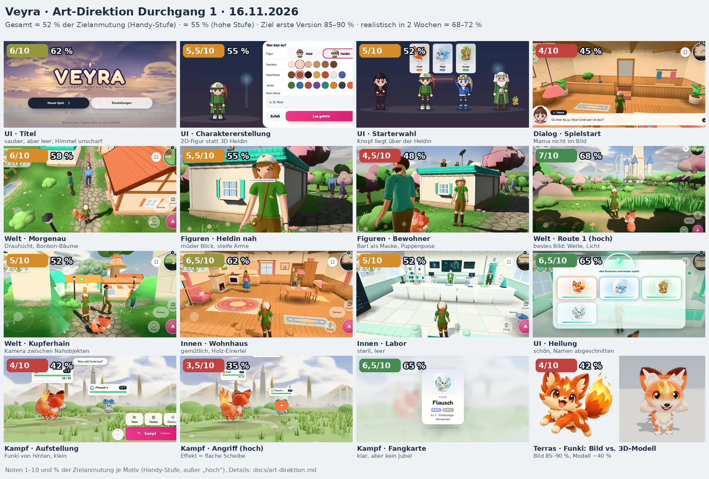

---

## 0. Kurzfassung

- **Heute: ≈ 52 % der Zielanmutung auf dem Handy (Stufe „mittel“), ≈ 55 % auf „hoch“.** Die Selbsteinschätzungen der Agenten (Welt 82–85 %, Terras 77–79 %, Figuren 73–80 %) messen den Fortschritt gegenüber ihrer eigenen Vorrunde, meist im Studiobild. Hier wird das fertige Spielbild am Handy gegen das Ziel gemessen – das ergibt deutlich weniger.
- **Was schon trägt:** die gemalten Terra-Bilder (≈ 85–90 % für sich genommen), das UI-System „Morgenglas“ (≈ 72 %), Himmel und Weitblick auf Route 1, gemütliche Wohnräume, die eigene Kristall-Fangkapsel, ruhiges, kindgerechtes Kampftempo, saubere Technik (Budget, LOD, keine Ruckler).
- **Was am stärksten bremst:**
  1. **Terras in 3D** (≈ 42 %): Die Modelle sind auf den ersten Blick nicht dieselben Wesen wie auf den Bildern (Proportion, Gesicht, Fell, Ausdruck).
  2. **Kampf-Inszenierung** (≈ 42 %): eigene Kreatur nur von hinten, Gegner klein; jeder Angriff ist derselbe kurze 2D-Punktekranz in Elementfarbe (wirkt zuerst wie eine flache Scheibe), ein Fang wird nicht gefeiert.
  3. **Kohärenz** (≈ 45 %): vier Arten, Figuren darzustellen (gemaltes Porträt, 2D-Intro-Figur, 2D-Dialogporträt, 3D-Modell), und zwei Arten für Terras (Bild bzw. Modell).
  4. **Figuren** (≈ 55 %): Gesichter maskenhaft und müde, steife Puppenhaltung, Bärte als schwarze Flächen, Hände als Klötze.
- **Zwei Wochen, Top 12 (≈ 22 Runden à 2–4 h):** realistisch **≈ 65–70 %** auf dem Handy. 85–90 % sind in zwei Wochen **nicht** erreichbar.
- **Decke:**
  - Mit der heutigen Werkzeugkette (skriptgebaute Formen, per Code gemalte Texturen, Toon-Shader r128, Handy-Budget) liegt die Decke bei **≈ 70–72 % gesamt** (Terras in 3D ≈ 60–65 %).
  - Mit Strukturwechseln (gemalte Bilder im Kampf, Projektion der eigenen Bilder auf die Modelle, gebackenes Licht, leichtes Post-Processing, freie Basis- und Bewegungsdaten) **≈ 80 %**.
  - **85–90 %** brauchen Terra- und Figurenmodelle samt Animation auf professionellem Niveau (Mensch oder ein Werkzeug, das du bisher ausgeschlossen hast) und 6–10 Wochen.
- **Die 3 Dinge für den Ersteindruck eines Kindes:**
  1. Terras sehen aus wie auf ihren Bildern, vor allem im Kampf und als eigener Partner.
  2. Ein Kampf, der „knallt“, und ein Fang, der gefeiert wird.
  3. „Das bin ich!“: die eigene 3D-Heldin von der ersten Minute an, mit freundlichem Gesicht und Figuren, die man beim Sprechen sieht.
- **Entscheidungen für dich:** siehe Abschnitt 6. Die wichtigste: **Terras im Kampf als lebendige gemalte Bildfiguren** (entspricht deiner Entscheidung vom 12.11., 15:17), bis ein 3D-Modell die Bildprobe besteht.

---

## 1. Methode

### 1.1 Aufnahmen
Skript `test/artdir/shots.mjs` (Playwright, Chromium mit SwiftShader, Sperre `.chromium.lock`). Das Spiel ist `dist/index.html` mit `?modelle3d=1` und läuft den echten Ablauf: Titel → „Neues Spiel“ → Intro mit Charaktererstellung (Heldin) → Starterwahl (Funki) → Spielstart. Danach wird zu den Motiven gesprungen.

| Stufe | Gerät (Emulation) | Was das Spiel gewählt hat |
|---|---|---|
| **Handy** (`handy_*`) | 844×390 bei DPR 2, Touch, iPhone-Kennung, „Apple GPU“, Home-Bildschirm-App, **ohne** gfx-Parameter | Klasse „mobil“ → Stufe **mittel**, Handy-Budget ≤ 100 k Dreiecke / ≤ 60 Draw-Calls (Budget-Stufen 5–6), Renderauflösung 1478×683 |
| **hoch** (`hoch_*`) | 1280×720 bei DPR 1, Maus, dedizierte Grafik vorgetäuscht, `?gfx=hoch` | Stufe **hoch** (Schatten 2048, Bloom, volle Vegetation), PC-Budget ≤ 250 k / ≤ 150 |

Motive: Titel, Charaktererstellung, Starterwahl, erster Dialog (Mama), Morgenau (weit, nah an Heldin und Bewohnern), Dialog in der Welt, Ladebildschirm, Route 1, Kupferhain, Wohnhaus, Laden, Labor, Heilstation mit Heil-Sequenz, Wildkampf (Aufstellung, Attackenwahl, Angriff, Fang, Fangkarte) sowie Chronik, Team, Dex, Tasche und Optionen. Insgesamt 58 Bilder in `test/artdir/` (27 Handy, 28 hoch, 3 Zusammenstellungen), alle WebP unter 300 KB.

### 1.2 Was die Emulation verfälscht und wie das ausgeglichen wurde
- **SwiftShader rendert 1–10 s pro Bild.** Der Wachhund (61) und die Auto-Auflösung (43) hätten deshalb jede Szene auf Renderskala 0,5–0,7 bzw. „niedrig“ gezogen (Notbremse). Beide wurden im Skript **eingefroren**. Die Bilder zeigen also die Stufe, die das Spiel gewählt hat, bei Renderskala 1,0 – so, als hielte das Gerät sein Bildziel. Ob das echte iPhone das schafft, bleibt eine Frage für Stabilität.
- **Bewegung und Timing:** Angriff und Fang wurden in **Zeitlupe ×0,06** aufgenommen (Spielzeit läuft mit 6 % der Echtzeit, nur im Aufnahmeskript). Daraus entstanden Serien mit 0,3 s Spielzeit pro Bild (Zwischenordner, Auswahl in `test/artdir/hoch_kampf_*`). Gang und Lauf wurden aus `test/figuren2/noa_gang_reihe.webp` und den Clip-Bildern der Terras beurteilt.
- **Modell-Ladezeiten** betrugen in der Emulation 100–240 s pro Ort (Blender lief parallel). Auf dem Gerät sind laut Stabilität 0,2–0,5 s je Modell zu erwarten. In die Bewertung geht das nicht ein; es wurde immer gewartet, bis alle Modelle da waren.

### 1.3 Stand der Figuren-Modelle
Während der Aufnahmen hat der Figuren-Agent `dist/` um 13:28 mit Zwischenständen von Runde 6 neu gebaut (Heldin, Mama, Mirael, Rayan, Veyran, Bewohner a–c; nicht committet).
- **Handy-Bilder:** Heldin, Mama und Bewohner im Stand R5, Veyran (Labor) und Mirael (Station) bereits R6.
- **Hoch-Bilder:** durchgehend R6-Zwischenstand.

Der Unterschied ist klein (feinere Haarsträhnen, siehe `test/figuren/r6_vergleich_*`) und ändert keine Note.

### 1.4 Prozent-Maßstab (Anker)
| % | Anmutung |
|---|---|
| 100 | Screenshots wirken spontan wie ein aktuelles, hochwertiges Nintendo-3D-Monsterspiel: stilisiert, sauber, lebendig, aus einem Guss |
| 80 | Hochwertiges Indie-3D: klarer eigener Stil, saubere Modelle, gutes Licht; kleine Schwächen in Details und Animation |
| 60 | Solides Hobby- bzw. Mobile-3D: Stil erkennbar, aber Spielzeug- oder Baukasten-Anmutung, steife Bewegungen |
| 40 | Prototyp: Teile wirken wie Platzhalter |

**Gewichtung für den Gesamtwert** (was ein Kind am meisten sieht und erlebt): Terras 25 %, Welt außen 20 %, Figuren 15 %, Kampf 15 %, UI 10 %, Kohärenz 7 %, Innenräume 5 %, Übergänge 3 %.

---

## 2. Bewertung je Bereich

### 2.1 Figuren (Heldin, NPCs, Hände, Haar, Gang) – **5,5/10 · 55 %** (hoch 57 %)

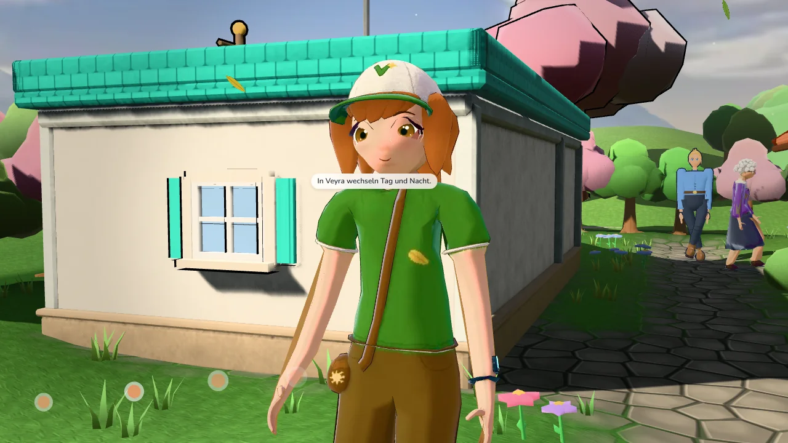
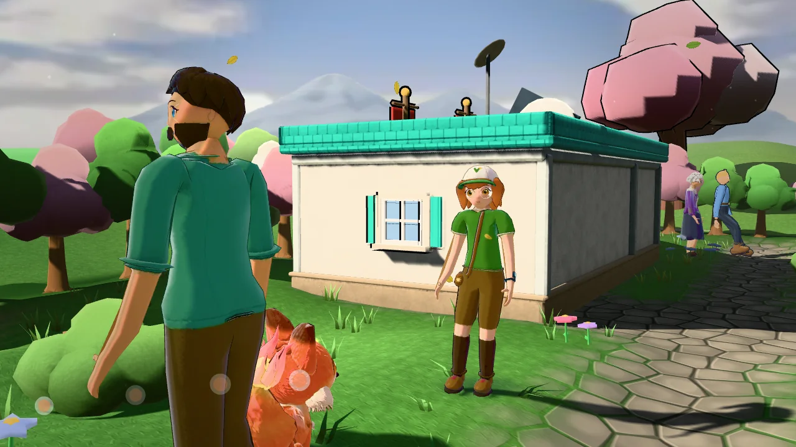

**Was trägt:**
- Die Silhouette der Heldin liest sich sofort (Schirmkappe, Pferdeschwanz, grünes Shirt, Umhängetasche).
- Die realistischen Proportionen entsprechen deiner Entscheidung „kein Chibi“.
- Kleidung mit Falten und Nähten; Haarvolumen seit R5 deutlich besser.
- Füße werden sauber gesetzt (IK), es gibt Blinzeln und Blicksprünge, NPCs drehen den Kopf zum Spieler.
- Budget und LOD sind gelöst (≤ 9 k Dreiecke, Umriss auf jeder Stufe).

**Mängel** (was, wo im Bild, warum es bricht):
1. **Das Gesicht wirkt müde und maskenhaft.**
   - Wo: `hoch_heldin_nah`, Bildmitte oben. Das Oberlid liegt über dem oberen Drittel der Iris, deshalb blickt die Heldin schläfrig oder skeptisch statt neugierig. Die Haut ist flach ohne Formschatten (keine Wangen- oder Nasenrundung), der Mund ist ein Strich.
   - Warum: Das Gesicht ist der wichtigste Qualitätsträger. Das gemalte Porträt `heldin_face_freudig` zeigt, wie sie wirken soll (offen, lachend); das Modell bleibt weit dahinter.
2. **Die Haltung ist steif.**
   - Wo: alle Figuren in `hoch_morgenau_nah`. Die Arme hängen gestreckt seitlich vom Körper weg (A-Pose), die Hände sind gespreizte Klötze, das Gewicht steht auf beiden Beinen. Die Figuren wirken wie Schaufensterpuppen.
   - Beim Laufen (`test/figuren2/noa_gang_reihe.webp`): Die Beine sind gut, aber der Oberkörper ist starr und die Hände werden wie ein Tablett gehalten (Handflächen oben, Handgelenk abgeknickt).
3. **Bärte und Haare als Flächen.**
   - Bürger c (`hoch_morgenau_nah`, links): Der Bart ist eine schwarze Maske über Kinn und Mund.
   - Prof. Veyran: Das Haar wirkt wie Wattebäusche.
   - Kittel und Röcke tragen dunkle Texturflecken (Mirael, Bürgerin b; `test/figuren/r6_vergleich_studio.webp`).
   - Haarsträhnen zeigen aus der Nähe Facetten wie Paddel.
4. **Die Hände sind Fingerblöcke (R5)** und lesen sich in jeder Nahaufnahme als Fäustlinge.
5. **Die Dialogregie fehlt:**
   - Beim ersten Satz des Spiels steht Mama hinter der Kamera; man sieht die Heldin von vorn und den Ausgang (`handy_dialog_mama`).
   - Ein Bewohner in Morgenau spricht mit dem Rücken zur Kamera (`handy_dialog`).
6. **Alle Frauen haben dasselbe Gesicht** (Mama, Mirael, Bürgerin a). Das verstärkt den Baukasten-Eindruck.

### 2.2 Terras (Form, Fell, Augen, Bewegung, Kampfposen, Treue zur Vorlage) – **4/10 · 42 %** (hoch 44 %)

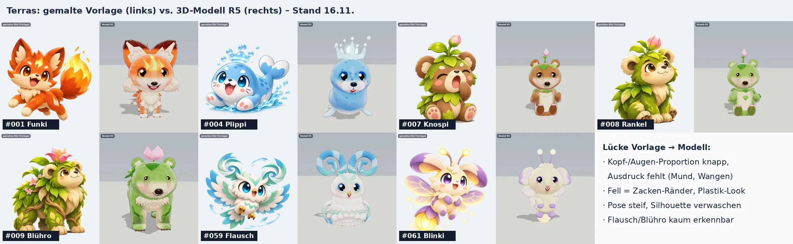

**Was trägt:**
- Die gemalten Bilder sind hervorragend: Ausdruck, Farbe, Appeal ≈ 85–90 % des Ziels.
- Die technische Werkzeugkette ist solide: Rig-Vorlagen für 6 Körperbautypen, gemeinsamer Clip-Satz, Feder-Nachschwingen, LOD, Budget.
- Wilde Terras laufen frei herum, der Partner folgt. Die Kristall-Fangkapsel ist eine eigene, schöne Form.

**Mängel:**
1. **Geringe Treue zur Vorlage** – man erkennt nicht sofort dasselbe Wesen:
   - Funki: Kopf als glatte Kugel mit aufgemalter Stirnflamme, Wangenfell wie Flügel.
   - Plippi: aufrecht wie ein Kegel statt rund und liegend.
   - Flausch: weißer „Eimer“ mit Widderhörnern, Flügel fehlen.
   - Blühro: grüner Plastikbär mit Kastenbeinen; die Blüte wirkt wie Origami.
   - Blinki: Flügel und Laterne fehlen weitgehend.

   Warum: Das Kind kennt die Kreatur von Karte, Dex und Team. Im Spiel trifft es dann eine andere.
2. **Die Oberfläche wirkt nicht wie Fell.**
   - Fellkanten sind gezackte Papierränder (Wangen, Brust, Ohr-Innenseiten).
   - Die Fellstrich-Textur rauscht wie Filz, dazu kommt Plastikglanz.
   - Es fehlt der weiche, helle Fellrand im Gegenlicht.
3. **Ausdruck und Bewegung sind zu klein.**
   - Die Mimik-Stufen (`test/terras2/r5_funki_mimik.webp`) sind kaum unterscheidbar.
   - Die Angriffspose ist ein Kopfnicken (`r2_anim_funki_idle_attack_joy.webp`); es gibt keine Vorspannung, kein Überschwingen, kein Strecken und Stauchen.
4. **Rückansicht als Klumpen.** In Welt und Kampf sieht man den Partner fast nur von hinten oder oben, als orangen Fellklumpen mit Feuerbüschel (`handy_kampf_aufstellung`, `handy_kupferhain`, unten). Sein Gesicht sieht das Kind fast nie.
5. **Gemischte Qualität:** 12 Arten sind als Modell gebaut, der Rest der Welt-I-Arten bleibt prozedural oder Bild. Für 48 Arten gibt es noch kein gemaltes Bild.

### 2.3 Welt außen (Gelände, Gras/Bäume, Häuser, Himmel, Licht, Kamera) – **6/10 · 60 %** (hoch 66 %)

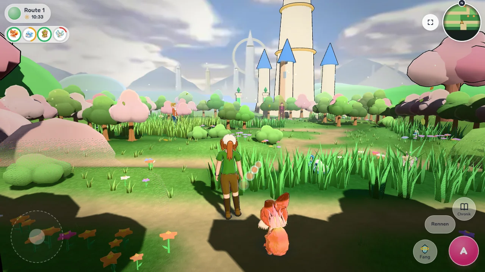
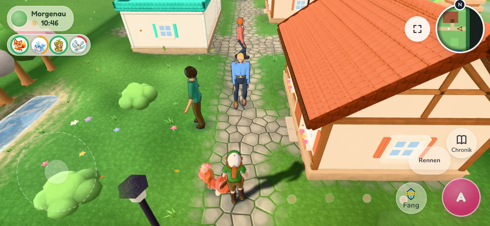
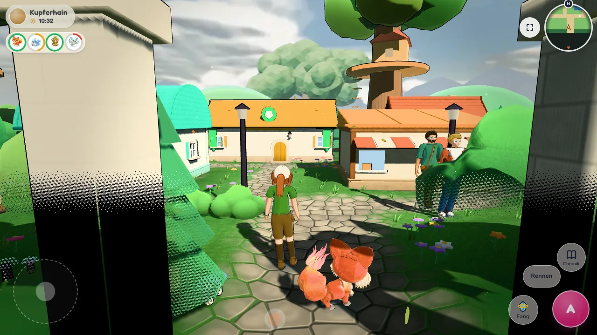

**Was trägt:**
- Helle, freundliche Farbwelt; der gemalte Himmel mit Wolken und die Bergkulisse geben Tiefe.
- **Route 1 hat echten Weitblick** (Burg, Hügel, Weg, hohes Gras, ein wildes Terra im Bild).
- Pflaster und Wege sehen gut aus, Gras-Büschel und Blumenwiesen stimmen.
- Auf „hoch“ geben Baum- und Hausschatten viel Tiefe.
- Orte haben eine Identität (Baumhaus in Kupferhain, Wahrzeichen).

**Mängel:**
1. **„Bonbon-Bäume“ beherrschen jedes Bild.**
   - Kronen als glatte Pastell-Kugelhaufen in Rosa, Weiß und Grün.
   - Rosa Kronen tragen teils dicke schwarze Umrisse (`hoch_morgenau_nah` oben rechts, `hoch_route1` links und rechts).
   - Warum: Die Bäume lesen sich als Spielzeug oder Watte, nicht als Natur mit Blattstruktur.
2. **Häuser sind glatte Kästen.**
   - Das Mint-Haus in Morgenau (`hoch_heldin_nah` Hintergrund) hat ein Flachdach, kleine Fenster und keine Requisiten. Es fehlen Zäune, Blumenkästen, Fässer, Bänke und Wäscheleinen; Dachüberstände werfen kaum Schatten.
   - Der Teich ist ein hellblaues Rechteck mit harter Kante (`hoch_morgenau_weit` links).
3. **Licht und Kamera:**
   - Auf dem Handy werfen nur Heldin plus 2 Modelle Schatten. Bäume und Häuser stehen schattenlos, das Bild wird flach (`handy_morgenau_weit` gegen `hoch_morgenau_weit`).
   - In Gassen fährt die Kamera steil nach oben (Morgenau: Draufsicht ohne Horizont).
   - In Kupferhain steht die Kamera bei Ankunft zwischen zwei Wandflächen. Große Vordergrund-Objekte zerfallen in ein grobes Punktgitter (Nahbereich-Ausblendung: Laterne, Busch, Hausecken).
4. **Kulissen und Ferne sind verwaschen.** Die Aurenstadt-Türme mit Ring im Hintergrund und die Bergsilhouetten im Titel sind unscharf, und der Dunst ist gleichförmig.
5. **Leitsystem:** Die orangen Wegweiser-Punkte (`crumbs`, 2D-Overlay) schweben als Blasen im Bild, oft über dem Steuerstick. Sie wirken wie ein Darstellungsfehler, nicht wie ein Teil der Welt.
6. **Farbe:** Das Gras ist durchgehend sattes Neongrün. Die eigene Regel R2 (Umgebung entsättigt, Kreaturen und Figuren gesättigt) ist umgekehrt: Terras und Figuren gehen gegen das Gras unter.

### 2.4 Innenräume (Haus, Laden, Labor, Station) – **6/10 · 58 %** (hoch 61 %)

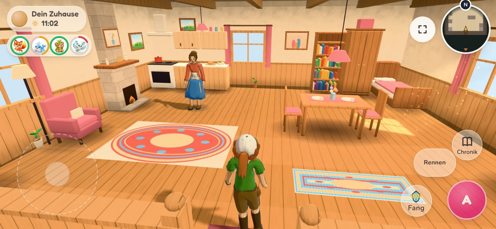
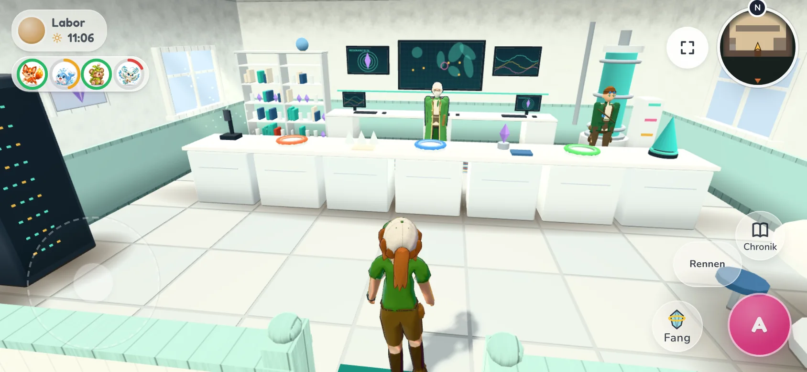
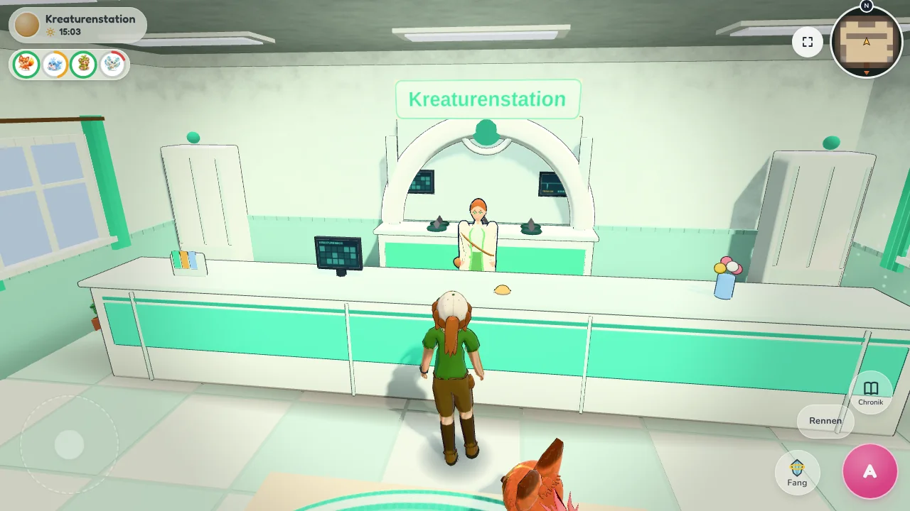

**Was trägt:**
- Das Wohnhaus ist gemütlich und lesbar (Küche, Kamin, Sessel, Esstisch, Regal, Bett, Teppiche, Sonnenflecken).
- Der Laden ist bunt und voll.
- Kollision und Darstellung stimmen überein, die Räume sind thematisch klar.

**Mängel:**
1. **Material-Einerlei:**
   - Haus und Laden: Boden, Wände, Decke und Möbel im selben Honigholz.
   - Labor und Station: Weiß mit Mint.
   - Es gibt kaum Verdeckungsschatten (AO) in Ecken und unter Möbeln; die Räume wirken wie aus einem Guss gefräst.
2. **Leer und steril:**
   - Labor und Station sind klinisch, mit großen leeren Bodenflächen.
   - Kein Terra lebt im Raum (z. B. ein Heil-Terra an der Theke), keine Poster, kaum Pflanzen. Das Heilgerät wirkt klein.
3. **Die Kamera schaut hoch und steil von hinten.**
   - Geländerpfosten und Lampenschirme liegen im Vordergrund (rosa Schirm in `handy_dialog_mama`).
   - Die Sprecherin ist nicht im Bild (siehe 2.1).

### 2.5 Kampf-Inszenierung (Kamera, Timing, Effekte) – **4/10 · 42 %** (hoch 44 %)

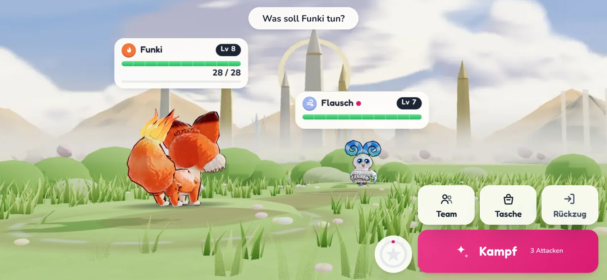
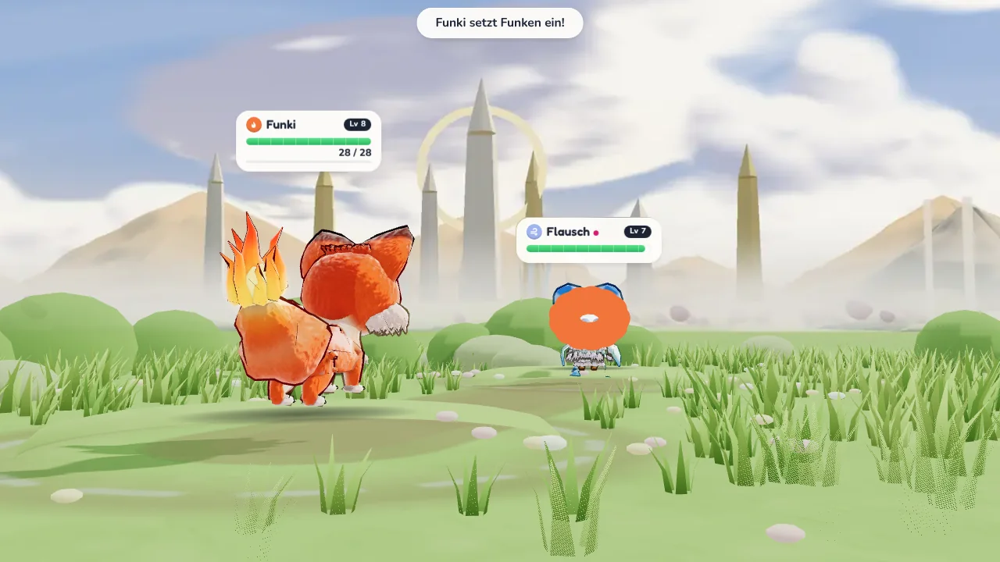
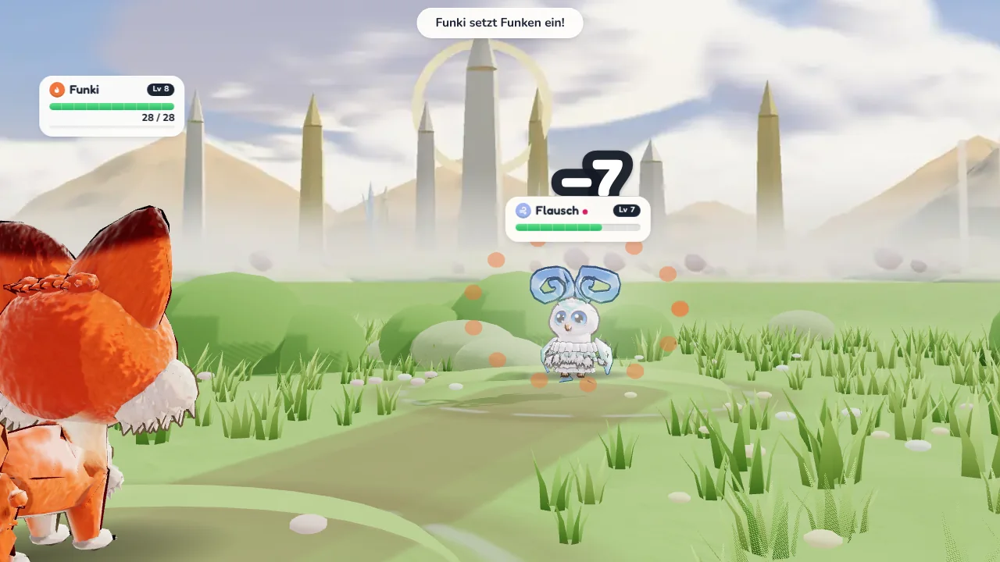
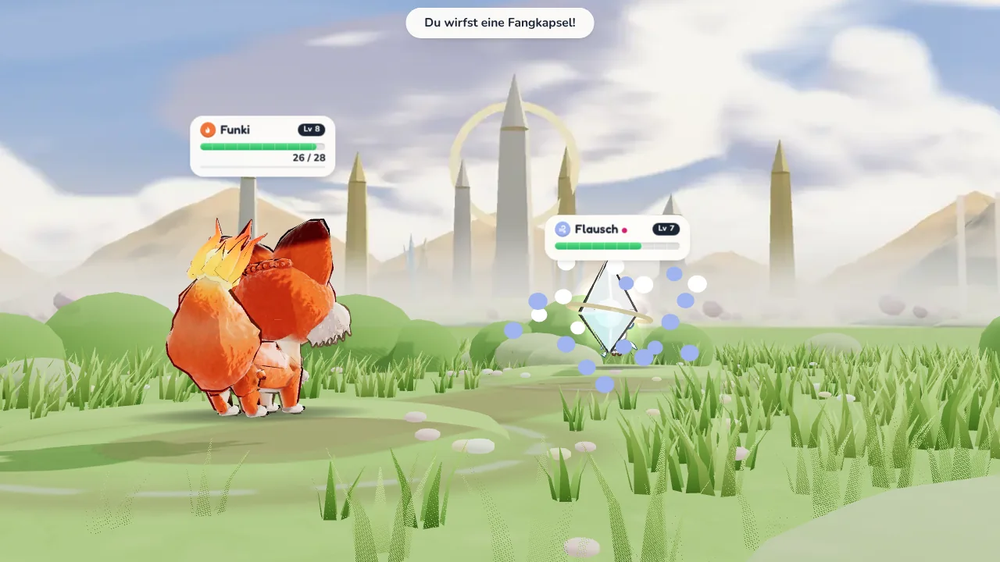

**Was trägt:**
- Ruhiges, kindgerechtes Rundentempo; große, gut lesbare Schadenszahl.
- Es gibt eine Kamera-Regie: Einfahrt, kurzer Fokus auf den Getroffenen.
- Der Arena-Boden passt zur Welt.
- Die eigene Kristallkapsel fliegt, saugt auf, wackelt dreimal und macht „Klick“ mit Goldring.
- Statuskarten mit KP-Verlauf.

**Mängel:**
1. **Bildaufbau:**
   - Funki ist zwar groß (≈ 35 % der Bildhöhe), steht aber frontal von hinten: Man sieht nur Rücken, Ohren und Flammenbüschel, als Fellklumpen.
   - Der Gegner steht klein in der Bildmitte (≈ 15–17 %).
   - Die Statuskarten sind größer als die Kreaturen.
   - Bei der Attackenwahl verdecken die Karten den Gegner (`handy_kampf_attacken`).
   - Warum: Im Kampf soll das Kind die Kreaturen groß und mit Gesicht sehen.
2. **Die Effekte sind generisch.**
   - Ablauf von „Funken“ in Spielzeit:
     - 0–1,7 s: nur Text.
     - 1,7 s: **14 Punkte in Elementfarbe**, die anfangs übereinanderliegen und wie eine flache orange Scheibe über dem Gegner wirken.
     - bis 2,3 s: Die Punkte öffnen sich zu einem Kranz (0,56 s), dazu Schnitt auf den Gegner und „−7“.
   - Es gibt kein Ausholen, keine Flamme, keinen Funkenflug, keinen Einschlag-Blitz mit Halt. Jedes Element sieht gleich aus, nur in einer anderen Farbe. Der Effekt ist ein 2D-Overlay über dem 3D-Bild (`10-mon3d.js`, `drawBattle`), er steht nicht im Raum.
3. **Fang und Sieg werden nicht gefeiert.**
   - Die drei Wackler dauern ≈ 3,5 s Spielzeit (Spannung ist in Ordnung), das „Klick“ ist aber nur ein kleiner Goldring an einer kleinen Kapsel.
   - Danach kommen Text und eine ruhige Karte: kein Funkenregen, keine Sterne, keine Jubelpose des Partners, keine Kamerafahrt zur Kapsel.
   - Der Partner dreht dem Kind die ganze Zeit den Rücken zu.

### 2.6 UI (Titel, HUD, Menüs, Schrift, Lesbarkeit am Handy, Kindgerechtigkeit) – **7/10 · 72 %** (hoch 74 %)

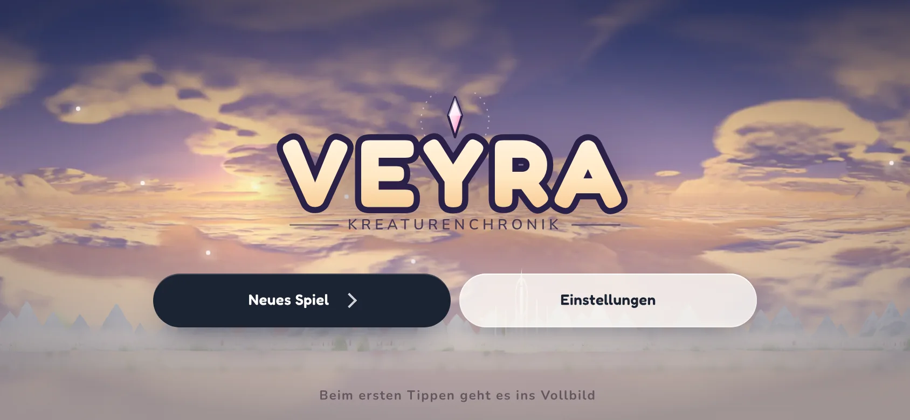
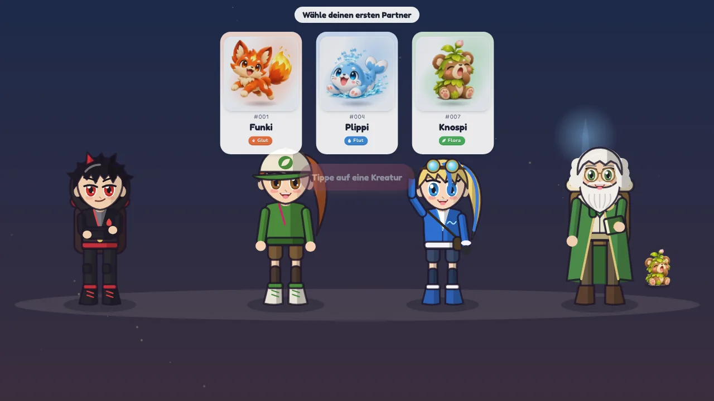
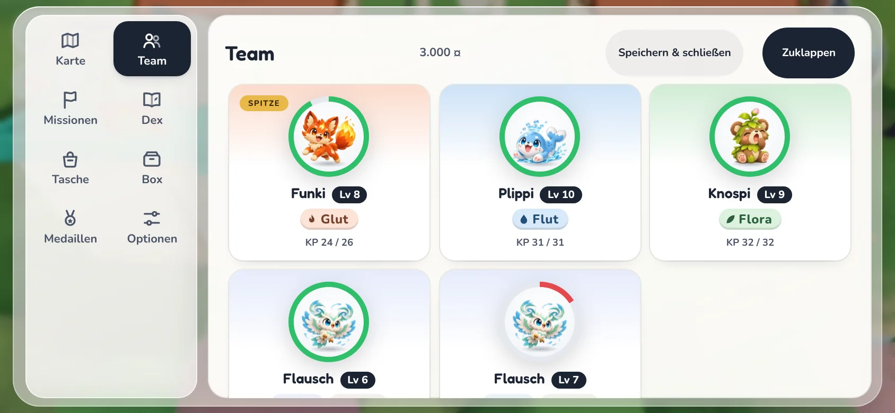
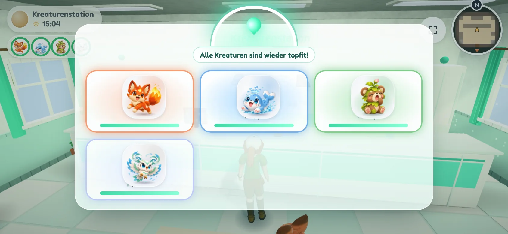

**Was trägt:**
- Das Designsystem „Morgenglas“ ist durchgängig: Milchglas, Fredoka/Nunito, eigene Symbole, ruhige Farben, Fuchsie nur für die Hauptaktion.
- Am Handy gut lesbar, Touch-Ziele groß.
- Team, Dex, Heilung und Fangkarte zeigen die gemalten Bilder; Dex mit Silhouetten für Gesehene.
- Klare Kampfkarten mit Typ-Symbolen, schönes Ortsschild, Minikarte und Team-Leiste.

**Mängel:**
1. **Der Ersteindruck ist schwächer als der Rest.**
   - Titel: unscharfer Himmel und Wortmarke, sonst leer.
   - Charaktererstellung: flache 2D-Vektorfigur statt der echten 3D-Heldin.
   - Starterwahl: Der Knopf „Tippe auf eine Kreatur“ liegt **über dem Gesicht der Heldin** (beide Bildgrößen, `hoch_starterwahl`).
2. **Für ein kleines Kind zu textlastig.**
   - Missionen in ganzen Sätzen, lange Beschreibungen in Tasche und Optionen, Währungszeichen „¤“.
   - Bewohner-Dialoge ohne Namen und Porträt.
   - In der Heil-Sequenz fehlen die Namen unter den Bildern (abgeschnitten, `handy_heilsequenz`).
3. **Kleine Darstellungsfehler:**
   - Wegweiser-Blasen (siehe 2.3).
   - Der Knopf „Rennen“ überlappt den Knopf „Chronik“ leicht (beide Größen).
   - Die Fangkarte hat keinen Jubel-Moment.

### 2.7 Übergänge / Ladebildschirm – **6,5/10 · 64 %**

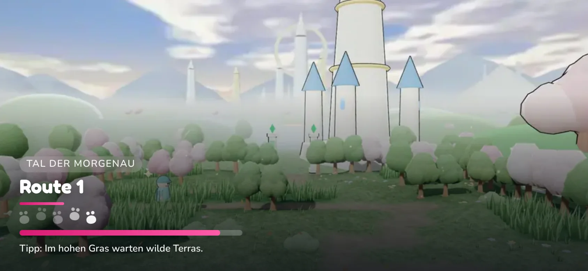

**Was trägt:**
- Die Regel stimmt: nur bei Gebietswechsel, Innenräume mit kurzer Blende.
- Gute Typografie (Region in Kapitälchen, großer Ortsname), Pfotenspur als Fortschritt, Tipp-Zeile.
- Dank Vorkompilieren kein Ruckler danach.

**Mängel:**
1. **Das Ortsbild ist unscharf und neblig.** Die Burg besteht aus weißen Zylindern mit schwarzen Umrisslinien, die Bäume sind matschig; das Bild wirkt wie ein Platzhalter-Render.
2. Die Text- und Fortschrittsgruppe sitzt klein links unten auf hellem Dunst. Auf kleinen Handys ist sie wenig präsent.
3. Der Kampfübergang wurde nicht im Bild bewertet (läuft, aber nicht Teil dieser Aufnahmen).

### 2.8 Gesamtkohärenz – **4,5/10 · 45 %**

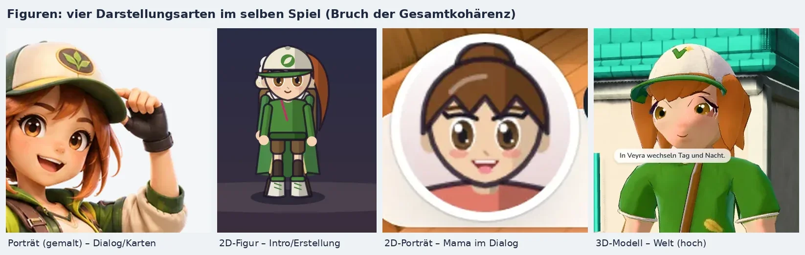

1. **Figuren in vier Stilen:**
   - gemaltes CG-Porträt (Dialog bei Hauptfiguren),
   - 2D-Vektorfigur im Chibi-Stil (Intro, Erstellung, Starterwahl),
   - 2D-Vektorporträt (Mama),
   - 3D-Modell (Welt).

   Das Kind sieht in den ersten fünf Minuten drei verschiedene „Heldinnen“.
2. **Terras in zwei Stilen:** Das hochwertige Bild (Karten, Dex, Heilung, Fang) und das deutlich schwächere 3D-Modell (Welt, Kampf) stehen direkt nebeneinander.
3. **Uneinheitliche Linien und Materialien:**
   - Dicke schwarze Umrisse an Bäumen und Fensterrahmen, dünne an Figuren, keine an Requisiten.
   - Die Welt ist glatt-pastellig, die Terras sind verrauscht-filzig, das UI ist glasig-modern.

### 2.9 Notentabelle

| Bereich | Note | % Handy | % hoch | Drei wichtigste Mängel |
|---|---|---|---|---|
| Figuren | 5,5 | 55 | 57 | müdes Maskengesicht · steife A-Pose/Klotzhände · Sprecher nicht im Bild |
| Terras | 4 | 42 | 44 | Modell ≠ Vorlage · Papierzacken-Fell, Plastik · Ausdruck/Bewegung zu klein, nur Rückansicht |
| Welt außen | 6 | 60 | 66 | Bonbon-Bäume mit schwarzen Linien · Kastenhäuser/Rechteck-Teich · flaches Handy-Licht, Kamera in Gassen/Nahobjekte |
| Innenräume | 6 | 58 | 61 | Material-Einerlei ohne AO · leer/steril · Kamera hoch, Sprecherin außerhalb |
| Kampf | 4 | 42 | 44 | eigene Kreatur nur von hinten, Gegner klein, Karten verdecken · ein generischer 2D-Punkteffekt für alle Elemente · Fang/Sieg ohne Feier |
| UI | 7 | 72 | 74 | Titel/Erstellung/Starterwahl schwächer (2D-Figuren, Knopf über Heldin) · zu textlastig fürs Kind · Wegweiser-Blasen/Überlappungen |
| Übergänge | 6,5 | 64 | 64 | Ortsbild unscharf · Textgruppe klein · Kampfübergang nicht geprüft |
| Kohärenz | 4,5 | 45 | 46 | 4 Figuren-Stile · Bild vs. Modell bei Terras · Linien/Materialien uneinheitlich |
| **Gesamt (gewichtet)** | **5** | **≈ 52** | **≈ 55** | |

---

## 3. Leitplanken ab Durchgang 1 (für alle Agenten, messbar)

1. **Maßstab ist das Handy-Bild** (844×390 bei DPR 2, Stufe mittel), nicht das Studiobild. Jede sichtbare Änderung wird damit abgenommen (`node test/artdir/shots.mjs handy <motiv>`).
2. **Kreaturen:**
   - Im Kampf nimmt der Gegner ≥ 25 % der Bildhöhe ein, die eigene Kreatur ≥ 30 %, Gesicht in Dreiviertelansicht sichtbar, nie reine Rückansicht.
   - Ein 3D-Modell ersetzt das gemalte Bild in Kampf und Nahansicht erst, wenn es die **Bildprobe** besteht: Note ≥ 7 neben der Vorlage, gleiche Proportion von Kopf, Augen und Ohren, gleicher Grundausdruck.
3. **Gesichter:**
   - Augen offen und freundlich: Iris zu mindestens ⅔ sichtbar, zwei Glanzpunkte; Grundausdruck Lächeln.
   - Bart und Haar als Volumen mit Licht und Schatten, nie als schwarze Fläche.
4. **Kamera:**
   - Erkundung höchstens 25° Neigung, Horizont sichtbar.
   - In Engstellen rückt die Kamera näher heran, statt höher zu fahren.
   - Kein Vordergrund-Objekt deckt mehr als 15 % des Bildes ab.
   - Im Dialog sind **Sprecher und Heldin im Bild** (Zwei-Schuss, Sprecher in Dreiviertelansicht zur Kamera).
5. **Umriss:** eine Regel für alles, abgedunkelte Eigenfarbe, ≤ 1 px am Handy, ≤ 1,5 px auf hoch. Keine schwarzen Linien an Vegetation und Gebäuden.
6. **Farbe:**
   - Umgebung gedämpft (Gras höchstens ≈ 70 % der heutigen Sättigung), Kreaturen, Figuren und Effekte gesättigt.
   - Pastell-Akzente (rosa Bäume) höchstens 15 % der Bildfläche.
7. **Licht:** Was den Boden berührt, hat AO oder einen Kontaktschatten. Auf dem Handy ohne Echtzeitschatten bekommen Bäume und Häuser gebackene oder vorgetäuschte Schatten.
8. **Effekte:**
   - Jedes Element hat ein eigenes Effektbild (Form, Farbe, Bewegungsrichtung).
   - Ablauf: Ausholen (0,2–0,4 s), Wirkung (0,3–0,6 s), Einschlag mit Weißblitz und 2–4 Bildern Halt.
   - Keine flachen Scheiben.
9. **Eine Figurendarstellung:** In Intro, Dialog und Welt erscheint dieselbe Figur. Porträts werden aus dem 3D-Modell gerendert, oder gemalte Porträts werden nur genutzt, wo das Modell dazu passt.
10. **Kind zuerst:**
    - Jede wichtige Information zusätzlich als Bild oder Symbol.
    - Belohnungsmomente (Fang, Sieg, Level, Entwicklung) werden gefeiert: Licht, Partikel, Ton, Pose.
    - Eingeblendete Hilfen gehören in die Welt (Bodenspur), nicht als 2D-Blasen darüber.

---

## 4. Top-12-Maßnahmen für die nächsten zwei Wochen

Nutzen = geschätzte Prozentpunkte des gewichteten Gesamtwerts (Handy), ehrlich und eher vorsichtig. Aufwand in Runden à 2–4 h. Sortiert nach Nutzen pro Aufwand. **E** = braucht eine Entscheidung von dir (Abschnitt 6).

| # | Maßnahme | Nutzen (pp) | Aufwand | Agent | Modell · Stufe | Abhängig von | E |
|---|---|---|---|---|---|---|---|
| 1 | **Kampf mit gemalten Terras als lebendige Bildfiguren** (3D nur nach Bildprobe je Art) | +5 (4–6) | 1–2 | terras-serie | Opus 5.5 · hoch | – | **E1** |
| 2 | **Kampf-Bildaufbau & Kamera** (Kreaturen groß, Dreiviertelansicht, Karten an den Rand, Schnitt Angreifer → Ziel) | +2 | 1 | terras-serie (+ ui-design für Karten) | Opus 5.5 · hoch | 1 | – |
| 3 | **Kamera Welt & Dialog** (Sprecher im Bild, näher statt höher, Horizont, keine Nahobjekte, feineres Ausblenden) | +1,6 | 1–2 | welt-grafik (Gegenprüfung stabilitaet) | Opus 5.5 · hoch | – | – |
| 4 | **Einheitlicher Toon-Look** (Umriss-Regel, Rim/Glanz/Sättigung angleichen, Bäume ohne schwarze Linien, Gras entsättigen) | +1 | 1 | welt-grafik | Opus 5.5 · hoch | – | **E2** |
| 5 | **Ortsbilder, Kulissen, Titelhimmel schärfen** (Ladebilder 2× und klarer, Aurenstadt-Kulisse 2048 px, Titelhimmel scharf) | +1 | 1 | welt-grafik (render_assets) + ui-design (Titel) | Sonnet 5.5 · hoch | 4 | (E6) |
| 6 | **Element-Effekte & Fang-Jubel** (8 Effektsätze, Einschlag mit Halt, Funkenregen/Sterne + Jubelpose + Kamerafahrt beim Fang) | +2,2 | 2–3 | welt-grafik (Partikel/Shader) + ui-design (Karte, Ton) | Opus 5.5 · hoch | 2 | – |
| 7 | **Partner zeigt Gesicht und reagiert** (geht seitlich vorn, schaut zur Kamera, Antippen = Hüpfer + Herz) | +0,8 | 1 | terras-serie | Opus 5.5 · mittel | – | – |
| 8 | **Intro, Erstellung, Starterwahl mit 3D-Figuren + einheitliche Porträts** (Drehbühne Heldin, Knopf-Fehler, Porträts aus 3D) | +1,8 | 2–3 | ui-design + figuren-npcs | Opus 5.5 · hoch | 10 (Gesichter) | – |
| 9 | **Welt-Licht** (gebackene AO und Kontaktschatten, Handy-Fake-Schatten für Bäume und Häuser, warm/kalt-Licht) | +1,4 | 2 | welt-grafik (+ stabilitaet misst Budget) | Opus 5.5 · hoch | 4 | (E5) |
| 10 | **Figuren: freundliche Gesichter & lockere Haltung** (Lider, Formschatten, Mund, Idle-Pose, Hände, Bärte, Gesichtsvarianten) | +1,6 | 2–3 | figuren-npcs | Opus 5.5 · hoch | R6 abschließen | – |
| 11 | **UI-Kinderliste & Fehler** (Wegweiser als Pfotenspur am Boden, Heil-Namen, Sprecherschild für Bewohner, Rennen/Chronik, Missionen mit Bild) | +0,9 | 1–2 | ui-design | Opus 5.5 · mittel | – | – |
| 12 | **Terras-Modelle an die Vorlage** (6 Kernarten: Projektion des gemalten Bildes, Silhouetten-Abgleich, weiche Fellbüschel, Ausdruck, Rückansicht) | +2 | 3–4 | terras-serie | Opus 5.5 · max | 1, **E4** | **E4** |

**Summe:** ≈ 21 pp nominell bei ≈ 22 Runden. Die Effekte überlappen, deshalb sind realistisch **+13 bis +18 pp → ≈ 65–70 %** zu erwarten.

**Danach (13–15):** Vegetation neu (+1,1 / 2 Runden), Häuser & Dorf-Requisiten mit natürlichem Teichufer (+1,0 / 2–3), Innenräume Licht & Leben (+0,7 / 2).

### 4.1 Steckbriefe (Ziel · Abnahme · nicht tun)

1. **Kampf mit Bildfiguren.**
   - Ziel:
     - Neuer Schalter (z. B. `SET.kampfBild`, Standard an): Im Kampf erscheint das gemalte Bild, solange die Art die Bildprobe (Leitplanke 2) nicht bestanden hat. Die Welt behält die Modelle.
     - Bildfigur mit Leben: Atmen (Skalierung 1–2 %), Idle-Wippen, Ausholen und Sprung beim Angriff (Strecken und Stauchen), Treffer-Zucken mit Weißblitz, Ohnmacht (Kippen + Ausblenden), Bodenschatten, Rim in Elementfarbe.
     - Eigene Kreatur gespiegelt links vorn, Gegner rechts, beide in Dreiviertelansicht.
   - Abnahme: Handy-Aufnahme `kampf`, Kreaturen ≥ 25/30 % Bildhöhe, gleiche Wirkung wie die Fangkarte.
   - Nicht tun: neue Bilder erzeugen (Entscheidung „keine neuen Bilder“). Arten ohne Bild behalten Modell oder Prozedur.
2. **Kampf-Bildaufbau.**
   - Ziel:
     - `CAMPOSE` in 35-transitions neu: Untersicht 5–10°, Gegner ⅓ rechts, eigene Kreatur links vorn angeschnitten.
     - Statuskarten kompakt in die oberen Ecken; Attackenkarten als Leiste unten, die den Gegner nicht verdeckt.
     - Beim Angriff 0,3 s Fokus auf den Angreifer, dann Schnitt aufs Ziel.
   - Abnahme: Zeitlupenserie mit `shots.mjs`: Ausholen, Wirkung und Treffer sind je in mindestens einem Bild klar erkennbar.
3. **Kamera Welt & Dialog.**
   - Ziel:
     - Kollisionsausweichen in 09 zuerst über den Abstand, erst danach über die Höhe.
     - Ankunftspunkte (Kupferhain-Eingang) so legen, dass keine Wand vor der Linse steht.
     - Nahbereich-Ausblendung feiner (4×4-Muster in voller Auflösung, zeitlich wechselnd) und nur für Objekte zwischen Kamera und Heldin.
     - Dialog-Zwei-Schuss über `CAM.mode 'dialog'` (gibt es schon).
     - Innenraum-Kamera 0,4 tiefer.
   - Abnahme: `dialog_mama` und `dialog` zeigen den Sprecher von vorn; `kupferhain` ohne Wand im Bild.
4. **Einheitlicher Toon-Look.**
   - Ziel:
     - Eine Umriss-Regel in 56-toonpro und 09 (Leitplanke 5).
     - Baumkronen ohne schwarzen Umriss, dafür dunklere Unterseite.
     - Gras −25 bis −30 % Sättigung (Leitplanke 6), Terras und Figuren +5 %; Rim-Stärke für Figuren, Terras und Welt angleichen.
   - Abnahme: Morgenau, Route 1 und Kampf – keine schwarzen Linien mehr an Bäumen und Fenstern.
5. **Ortsbilder und Kulissen.**
   - Ziel:
     - `tools/render_assets.mjs place` mit `?modelle3d=1`, doppelter Auflösung und weniger Dunst neu rendern.
     - Horizont-Kulissen (Aurenstadt, Berge) neu mit 2048 px; Titelhimmel in voller Schärfe.
   - Abnahme: Ladebild Route 1 – Burgtürme ohne schwarze Linien, scharf.
6. **Effekte und Fang-Jubel.**
   - Ziel:
     - Partikel im Kampf-Renderer, je Element: Glut = Funkenstrahl + Glutflocken, Flut = Wasserbogen + Spritzer, Flora = Blattwirbel, Böe = Windbänder, Fels = Steinsplitter, Lumen = Lichtstrahlen, Schatten = Rauchschleier, Frost = Eiskristalle.
     - Einschlag: Weißblitz + Halt + kleiner Kamerastoß bei Volltreffer.
     - Fang: Kamera fährt zur Kapsel, „Klick“ mit Sternenregen und Jingle, Partner jubelt (Clip `joy`), Karte springt mit Federbewegung auf.
     - Budget: ≤ 2 Draw-Calls für alle Effekte (gemeinsame Instanzen).
   - Abnahme: Zeitlupenserie – je Element ein eigenes Bild.
7. **Partner zeigt Gesicht.**
   - Ziel:
     - Der Begleiter läuft schräg vor der Heldin (rechts vorn statt hinten) und dreht im Stand den Kopf zur Kamera.
     - Antippen löst Hüpfer + Herz-Emote + Ruf aus; beim Betreten eines neuen Ortes eine Freude-Geste.
   - Abnahme: In `handy_route1` und `handy_kupferhain` ist das Gesicht des Partners sichtbar.
8. **Intro in 3D.**
   - Ziel:
     - Erstellung zeigt die 3D-Heldin bzw. den 3D-Held auf einer Drehbühne; Farbwahl wirkt live, nach „Los geht's!“ winkt die Figur.
     - Starterwahl: Rayan, Mira und Veyran als 3D-Modelle oder als gerenderte Porträts; Knopf „Tippe auf eine Kreatur“ unter die Karten.
     - Dialogporträts für Figuren ohne gemaltes Porträt aus dem 3D-Kopf rendern (Mama, Bewohner).
   - Abnahme: `erstellung`, `starterwahl` und `dialog_mama` zeigen dieselbe Heldin wie die Welt.
9. **Welt-Licht.**
   - Ziel:
     - AO als Eckenfarbe für Häuser, Zäune und Felsen sowie als weicher Bodenfleck unter Bäumen und Häusern (eine Instanz-Ebene).
     - Handy: vorgerechnete Schattenflecken in Sonnenrichtung.
     - Licht: Hauptlicht warm, Schatten kühl.
   - Abnahme: `handy_morgenau_weit` gegen heute – Häuser und Bäume „stehen“ auf dem Boden; Budget ≤ 100 k / ≤ 60 bleibt.
10. **Figuren-Gesichter und Haltung.**
    - Ziel:
      - Oberlid höher, Iris größer, zweiter Glanzpunkt; Formschatten über die Gesichtsnormalen (Wangen- und Nasenrundung).
      - Mund als Form mit Mundwinkeln, Grundausdruck Lächeln.
      - Idle: Arme am Körper, Ellbogen leicht gebeugt, Hände entspannt, Gewicht auf einem Bein; Laufen mit lockeren Händen.
      - Bärte als Volumen-Strähnen; 3 Gesichtsvarianten für Frauen und Männer.
    - Abnahme: `heldin_nah` – „neugierig/froh“ statt „müde“; Note ≥ 7 neben `heldin_face_freudig`.
11. **UI-Kinderliste.**
    - Wegweiser als leuchtende Pfotenabdrücke in 3D am Boden (tiefengetestet, perspektivisch) statt 2D-Blasen.
    - Namen in der Heil-Sequenz; Sprecherschild „Bewohnerin“ mit Porträt.
    - Knöpfe Rennen und Chronik ohne Überlappung.
    - Missionskarte mit Zielbild (Ort oder Figur) + 1 Satz; „¤“ durch ein eigenes Münzsymbol ersetzen.
12. **Terras an die Vorlage.**
    - Ziel:
      - Gemaltes Bild per Blender-Skript als Projektion auf die Front backen (Augen, Wangen, Abzeichen), Seiten aus den Bildfarben verlängern.
      - Silhouetten-Abgleich: Modell von vorn/dreiviertel rendern, Maske mit der Bildmaske vergleichen, Proportionen per Optimierung anpassen.
      - Fell: weiche Büschel mit runden Spitzen statt Zacken, heller Fellrand im Gegenlicht.
      - Grundausdruck mit offenem, lachendem Mund wie im Bild.
      - Zuerst Funki, Plippi, Knospi, Flausch, Knabbi, Blinki.
    - Abnahme: Bildprobe ≥ 7 (Leitplanke 2) – erst dann darf das Modell auch im Kampf erscheinen.

### 4.2 Vorschlag für den Ablauf (2 Bau-Agenten parallel + Art-Direktor-Abnahme; 2 Kerne, Sperren beachten)
| Tage | Agent A | Agent B | Abnahme |
|---|---|---|---|
| 1–3 | terras-serie: 1 → 2 → 7 | welt-grafik: 4 → 3 → 5 | Art-Direktor (Opus 5.5 · hoch) nach jeder Maßnahme mit `shots.mjs handy <motiv>` |
| 4–7 | welt-grafik: 6 (Effekte) | figuren-npcs: R6 fertig → 10 | Zwischenstand Gesamt (≈ 60 % erwartet) |
| 8–11 | ui-design: 8 → 11 | welt-grafik: 9 | Regression: Sonnet 5.5 · hoch (`smoke`, `uebergaenge_qa`, `stabil_qa`) |
| 12–14 | terras-serie: 12 (Funki, Plippi, Knospi zuerst) | Puffer / 13–15 | Durchgang 2 der Art-Direktion |

---

## 5. Ehrliche Decken-Einschätzung

### 5.1 Sind 85 % mit skriptgebauten Modellen und gemalten Texturen erreichbar?
**Nein, nicht gesamt und nicht in zwei Wochen.** Gemeint sind Texturen, die per Code gemalt werden – die vorhandenen gemalten Bilder sind etwas anderes, siehe unten.

Die Werkzeugkette ist technisch sauber; ihre Grenze liegt bei den **organischen Formen und beim Ausdruck**:
- Terras und Gesichter entstehen aus Lofts, Skin-Graphen und Primitiven.
- Die Texturen sind Rauschen und Verläufe, nicht gemalt.
- Animationen werden per Code gekeyt.

Damit erreicht man klare, einfache Formen (Häuser, Requisiten, Möbel, Kleidung), aber kaum die weichen Übergänge, die Asymmetrien und die Mimik, die „Appeal“ ausmachen. Die Terras-Serie zeigt das: In fünf Runden stieg die Treue zur Vorlage nur langsam, und jede Runde bringt weniger.

### 5.2 Decke je Bereich
| Bereich | heute | nach Top 12 | Decke heutige Werkzeugkette | mit Strukturwechsel (5.3) |
|---|---|---|---|---|
| Figuren | 55 | ≈ 66 | 70–75 | 82–88 |
| Terras | 42 | ≈ 64 (Kampf als Bildfigur) | 60–65 in 3D | 85–90 |
| Welt außen | 60 | ≈ 68 | 75–80 | ≈ 85 |
| Innenräume | 58 | ≈ 63 | ≈ 75 | ≈ 85 |
| Kampf | 42 | ≈ 65 | ≈ 75 | ≈ 88 |
| UI | 72 | ≈ 79 | ≈ 90 | ≈ 92 |
| Übergänge | 64 | ≈ 74 | ≈ 85 | ≈ 90 |
| Kohärenz | 45 | ≈ 62 | ≈ 70 | ≈ 85 |
| **Gesamt** | **≈ 52** | **≈ 65–70** | **≈ 70–72** | **≈ 80 (85 mit Profi-Modellen)** |

### 5.3 Was sich strukturell ändern müsste (für 80 %, dann 90 %)
1. **Die eigenen Bilder dort zeigen, wo man nah hinsieht** (Maßnahme 1). Das ist der größte und billigste Sprung: Die gemalten Terras sind bereits auf Zielniveau.
2. **Projektion statt „von Hand gemalt“.** Agenten können nicht frei Hand malen. Sie können aber die **eigenen gemalten Bilder** per Blender-Skript auf die Modelle projizieren und backen (Augen, Gesichtszeichnung, Farbfelder). Das ist der skriptbare Ersatz für handgemalte Texturen und bringt bei Terras-Gesichtern am meisten (+5–8 pp in diesem Bereich). Auch für Figurengesichter sind die Porträts (`*_face_*.webp`) als Quelle geeignet.
3. **Bessere Ausgangsformen.** Die Recherche (docs/recherche-3d-qualitaet.md, „Weg (d)“) empfahl für Figuren eine **freie Basis mit sauberer Topologie und Rig** (z. B. CC0-Menschbasis); gebaut wurde stattdessen aus Skin-Modifiern. Für Terras gilt dasselbe mit freien Tier-Basismodellen. Beides braucht Downloads mit dokumentierter Lizenz (E4).
4. **Animation mit Vorspannung, Überschwingen sowie Strecken und Stauchen**, dazu Mimik-Knochen (Lider, Brauen, Mundwinkel, Ohr- und Schwanzketten). **Mehr Knochen** bringen allein nur +2–3 pp – entscheidend sind ausdrucksstarke Clips. Für Menschen helfen freie Bewegungsdaten (Lizenz je Quelle prüfen).
5. **Gebackenes Licht** (AO und Lightmaps aus Blender für Häuser, Innenräume, Felsen): Welt und Innenräume steigen um 5–10 pp, kostet am Handy fast nichts.
6. **Leichtes Post-Processing am Handy** (Bloom in ¼-Auflösung für Leuchtteile und Effekte, Farb-LUT je Region, Tiefenunschärfe in Kampf und Dialog): +2–4 pp. Widerspricht der alten Regel „kein Postprocessing“ in AGENTS.md (auf „hoch“ schon aufgeweicht) → E5, nur mit Messung am iPhone.
7. **Für 85–90 %:** Terra- und Figurenmodelle sowie Animation auf professionellem Niveau. Realistische Wege:
   - **(a)** ein 3D-Künstler im Auftrag für die 3 Starter-Linien + Heldin + 3 Haupt-NPCs,
   - **(b)** Bild-zu-3D-Werkzeuge (von dir bisher ausgeschlossen),
   - **(c)** dauerhaft die Bildfiguren im Kampf und 3D nur in der Welt auf Abstand.

   Ohne einen dieser Wege bleibt 3D bei Terras bei ≈ 60–65 %.

### 5.4 Die 3 Dinge mit der größten Wirkung auf den Ersteindruck eines Kindes
1. **„Mein Terra ist so süß wie auf dem Bild.“** Im Kampf die lebendige Bildfigur (1). In der Welt zeigt der Partner sein Gesicht, hüpft und freut sich beim Antippen (7).
2. **„Der Kampf macht Bumm, und der Fang ist ein Fest.“** Große Kreaturen im Bild, Funken, Wasser und Blätter je Element, Einschlag mit Blitz (2, 6); beim Fang Sternenregen, Jubel des Partners und eine Karte, die aufspringt.
3. **„Das bin ich!“** Die eigene 3D-Heldin von der ersten Minute an, auf der Drehbühne mit Farbwahl. Sie lächelt offen, Mama und der Professor stehen beim Sprechen sichtbar vor ihr und winken (3, 8, 10).

---

## 6. Offene Entscheidungen für dich

| # | Frage | Empfehlung |
|---|---|---|
| **E1** | Terras im Kampf als **lebendige gemalte Bildfiguren**, bis ein 3D-Modell die Bildprobe besteht? (Die Terras-Serie hat seit 12./13.11. Modelle auch im Kampf gezeigt.) | **Ja.** Entspricht deiner Entscheidung vom 12.11., 15:17 („im Kampf erscheint das gemalte Bild“) und ist der größte Einzelhebel (+4–6 pp). |
| **E2** | Umriss „dünn“ oder „fast keiner“ (seit 13.11. offen) | **Dünn und farbig:** abgedunkelte Eigenfarbe, ≤ 1 px am Handy; an Bäumen und Häusern keiner. Hilft der Lesbarkeit kleiner Figuren am Handy. |
| **E3** | Erste Version als **Schaufenster der ersten Spielstunde** (Titel → Intro → Morgenau → Route 1 → Kupferhain mit Kampf, Fang, Station) zuerst auf ≈ 70 % polieren, Rest danach? | **Ja.** Dort entsteht der Ersteindruck; alle Top-12-Maßnahmen wirken genau dort. |
| **E4** | Welcher Strukturweg für Terras und Figuren über ≈ 70 % hinaus? | Erst (a); (b) und (c) prüfen; (d) ist deine Entscheidung. Ohne (c) oder (d) bleibt die Decke für 3D-Terras bei ≈ 60–65 %. |
| **E5** | Leichtes Post-Processing auch am Handy erlauben (Bloom ¼, Farb-LUT, Tiefenunschärfe in Kampf und Dialog)? AGENTS.md-Regel anpassen? | **Ja, testweise**, mit Messung am iPhone (Stabilität). |
| **E6** | Titelbild: Heldin und Partner zeigen? (Wunsch vom 10.11.: keine Kreaturen im Titelbild.) | Heldin mit Partner-Silhouette im Gegenlicht vor der Burg – oder bewusst so lassen. Kleiner Hebel, nur Geschmack. |

Wege für **E4**:
- **(a)** Projektion der eigenen gemalten Bilder auf die Modelle – kein Fremdmaterial, sofort möglich.
- **(b)** freie Basismodelle und Bewegungsdaten (CC0, Lizenz je Datei in docs/).
- **(c)** 3D-Auftragsarbeit für die Starter-Linien und die Heldin (Budget).
- **(d)** Bild-zu-3D-Werkzeuge (bisher ausgeschlossen).

---

## 7. Vom Art-Direktor selbst entschieden (vermerkt)
- **Handy-Stufe:** iPhone-Emulation (Apple GPU, Touch, Home-Bildschirm-App) ohne gfx-Parameter; das Spiel wählte „mittel“ und das Handy-Budget. Wachhund und Auto-Auflösung wurden eingefroren (SwiftShader-Bremse, siehe 1.2).
- **Hohe Stufe:** dedizierte GPU vorgetäuscht, damit „hoch“ mit PC-Budget statt des Budgets für integrierte Grafik läuft (SwiftShader würde sonst „integriert“ melden).
- **Spielfigur:** die **Heldin** (du spielst sie); Starter Funki; Gegner Flausch Lv 7 auf Route 1 (häufigste Wildart dort); Attacke „Funken“ (Glut).
- **Zeitlupe ×0,06** nur im Aufnahmeskript, um Angriff und Fang Bild für Bild zu sehen.
- **Ein Seitenfehler** („Cannot set properties of null (setting 'cap')“) entstand in der hoch-Aufnahme, weil das Skript den Kampf beendete, während die verlangsamte Fang-Sequenz noch lief. Das ist **kein** Spielfehler; das Skript wartet jetzt das Ende des Fangs ab.
- **Gewichtung des Gesamtwerts** wie in 1.4. Die Noten bewerten das Handy-Bild, „hoch“ steht als Zusatz daneben.
- **Rollenfrage:** Für die Kampf-Inszenierung gibt es keinen eigenen Agenten. Sie ist terras-serie (Kampfszene, Kamera) und welt-grafik (Effekte) zugeordnet; die Karten macht ui-design.

---

## 8. Anhang

### 8.1 Messwerte der Aufnahmen (Dreiecke / Draw-Calls je Bild, Welt-Renderer)
| Ort | Handy (mittel, Budget-Stufe) | hoch |
|---|---|---|
| Morgenau | 99 k / 59 (5) – nah 82 k / 60 (6) | 220 k / 109 |
| Route 1 | 67 k / 59 (6) | 253 k / 134 |
| Kupferhain | 86 k / **64** (5) – über dem Handy-Ziel von 60 | 217 k / **151** (2) – über 150 |
| Wohnhaus · Laden · Labor · Station | 65 k / 32 · 78 k / 32 · 56 k / 30 · 54 k / 32 | 113 k / 38 · 158 k / 38 · 78 k / 37 · 73 k / 39 |

Der Kampf läuft über einen eigenen Renderer und ist hier nicht erfasst. Renderauflösung: Handy 1478×683 (DPR-Deckel 1,75), hoch 1280×720.

### 8.2 Erzeugte Dateien
- `docs/art-direktion.md` (dieses Dokument)
- `test/artdir/shots.mjs` (Aufnahmeskript)
  - Aufruf: `LOCK=/home/claude/veyra/.chromium.lock; until mkdir "$LOCK" 2>/dev/null; do sleep 5; done; trap 'rmdir "$LOCK"' EXIT; node build.mjs && node test/artdir/shots.mjs <handy|hoch> [motiv,…]`
  - Motive: `titel, erstellung, starterwahl, dialog_mama, morgenau_weit, morgenau_nah, dialog, laden_route1, route1, kupferhain, innen_haus, innen_laden, innen_labor, heilstation, kampf, menues`
  - Zwischenbilder (Serien) über `AD_TMP=<ordner>`
- `test/artdir/uebersicht.webp`: Übersichtsblatt, 16 Motive mit Note und %.
- `test/artdir/terras_vorlage_vs_modell.webp`: 7 Arten, Vorlage gegen Modell R5.
- `test/artdir/kohaerenz_figuren.webp`: vier Figuren-Stile.
- `test/artdir/handy_*.webp` (27) und `test/artdir/hoch_*.webp` (28):
  - Welt und UI: Titel, Erstellung, Starterwahl, Dialog Mama, Morgenau weit und nah, Heldin nah, Dialog, Ladebild, Route 1 (Handy zusätzlich `route1_nach`), Kupferhain.
  - Innen: Haus, Laden, Labor, Station, Heilsequenz.
  - Kampf:
    - Handy: Aufstellung, Attacken, Treffer, Fang.
    - hoch: Aufstellung, Attacken, Angriff a/b, Fang a/b.
    - Beide: Fangkarte.
  - Menüs: Chronik, Team, Dex, Tasche, Optionen.
